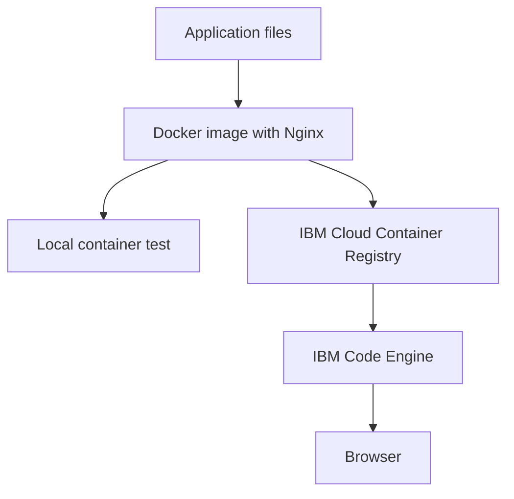
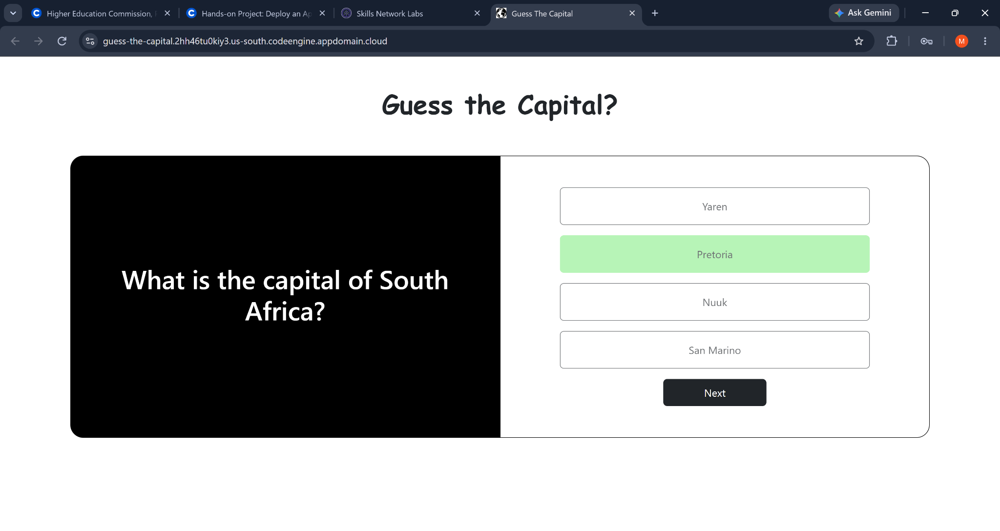

# IBM Cloud Container Deployment

A hands-on deployment lab completed by Mansoor Ahmad Jan on 22 November 2026 as part of IBM's Introduction to Cloud Computing course.

## Overview

The supplied Guess the Capital JavaScript application was containerized with Nginx, tested in Docker, uploaded to IBM Cloud Container Registry, and deployed using IBM Code Engine.

## Architecture



## Run locally

```bash
docker build -t guess-the-capital .
docker run --rm -p 8080:80 guess-the-capital
```

Open http://localhost:8080.

## Cloud deployment

In the IBM Skills Network lab, with a configured Code Engine project and registry namespace:

```bash
docker build . -t us.icr.io/${SN_ICR_NAMESPACE}/guess-the-capital
docker push us.icr.io/${SN_ICR_NAMESPACE}/guess-the-capital
```

Create a Code Engine application using the uploaded image, the configured registry secret, and container port 80. Verify with:

```bash
ibmcloud ce application get --name guess-the-capital
```

## Results

The image was built successfully, the container was tested on port 8080, and the application was verified at its Code Engine HTTPS endpoint. The lab environment is temporary; the original deployment may expire.



## Learning outcomes

- Docker image builds and container port mapping
- Nginx-based static application hosting
- Container registry tagging and publishing
- Serverless deployment and verification

## Attribution and license

Original application and guided lab: [IBM Skills Network](https://github.com/ibm-developer-skills-network/fyidw-guess-the-capital). The Dockerfile was modified following the lab instructions; this repository documents the deployment exercise, not original application development. See the original Apache 2.0 LICENSE.
